# Ascension Gates
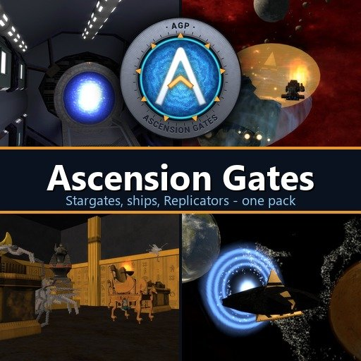
> Stargates, rings, ships, Replicators and power - all in one pack.

Ascension Gates is based on Carter's Addon Pack and CAP Enhanced. It adds bug fixes and many new parts, and every text comes in 12 languages. Old saves and dupes keep working: the parts kept their names.

## Install
**Steam Workshop (easiest):** subscribe to [Ascension Gates](https://steamcommunity.com/sharedfiles/filedetails/?id=3840679305) - Steam brings everything it needs with it.

**By hand:** download four zips and unpack them into `garrysmod/addons/`: `ascension_gates-1.0.3.zip` (the code) from
the [latest release](../../releases/latest), and `ascension_gates_res1`, `_res2`, `_res3` (models, sounds, maps and
materials, 2.9 GB together) from [release 1.0.2](../../releases/tag/v1.0.2) - the content has not changed since,
so it is needed only once. It also needs
[PowerGrid](https://github.com/moonrise420/powergrid) and [Wiremod](https://github.com/wiremod/wire).

## Bugs, problems and wishes
Please use [Issues](../../issues): pick *Bug report* or *Wish or idea*. On the Steam Workshop page the comments work too.

## Pictures

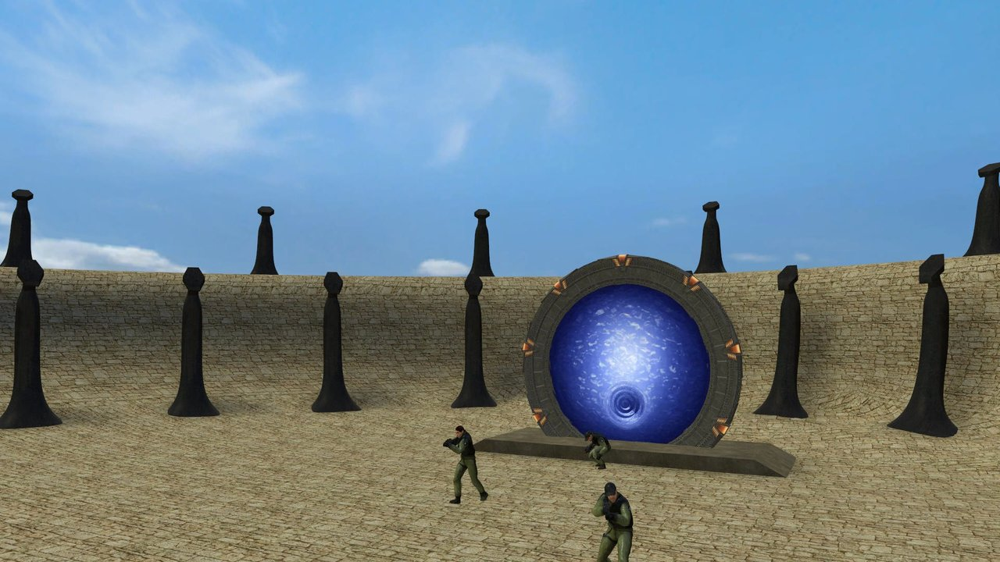
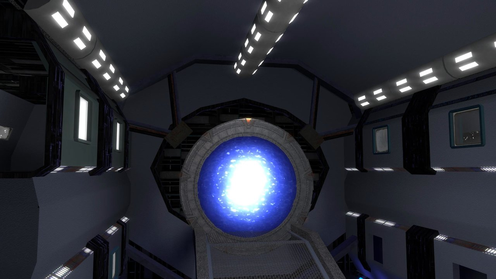
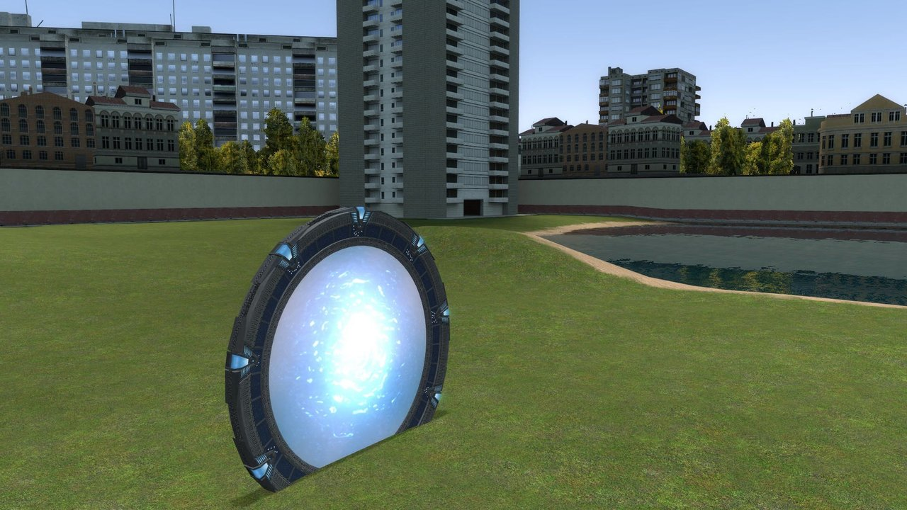
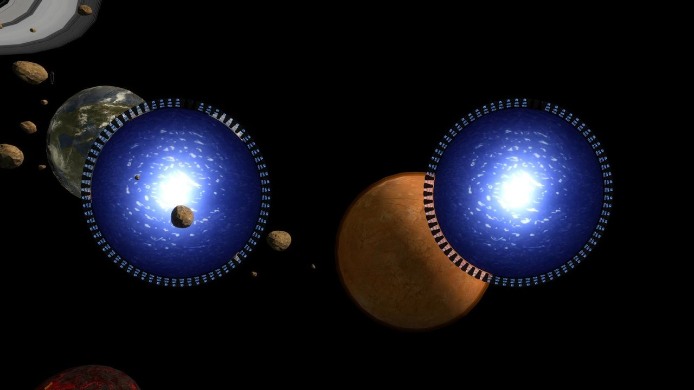
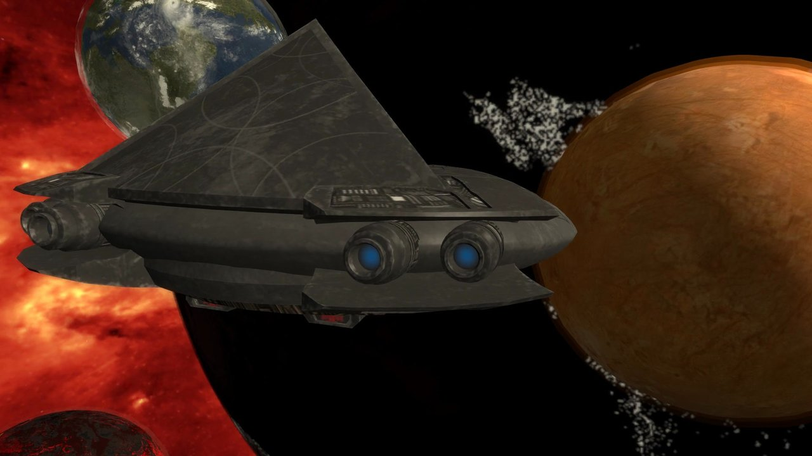
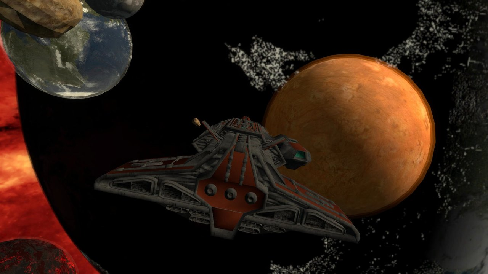
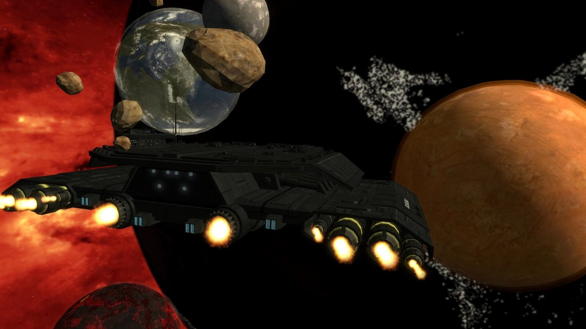
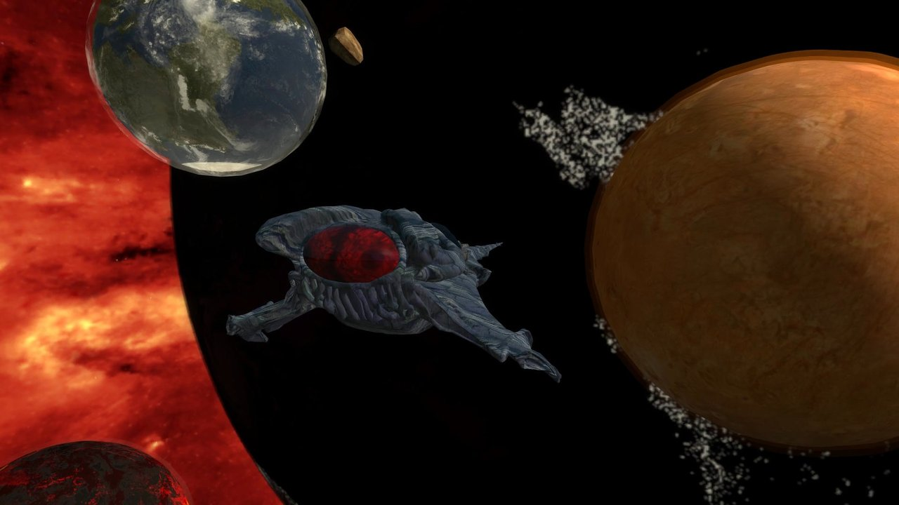
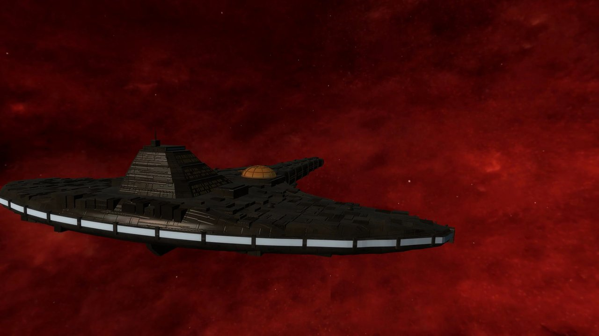
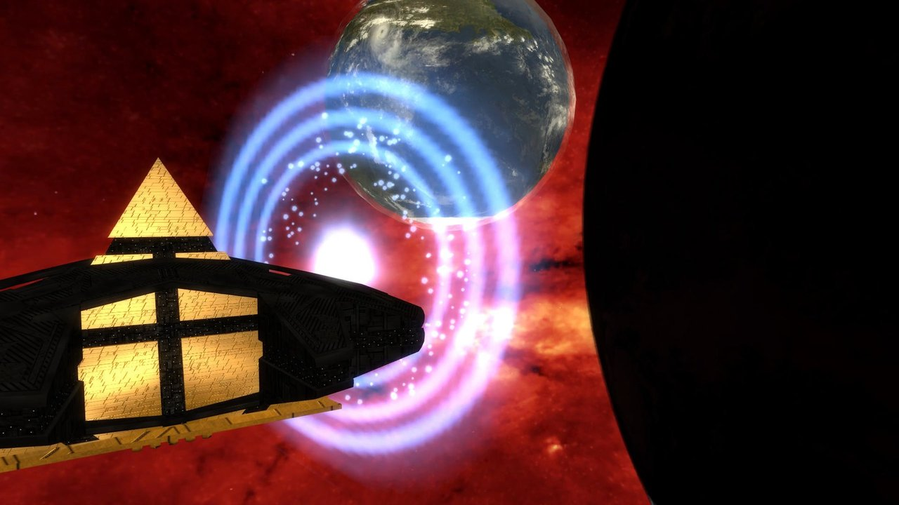
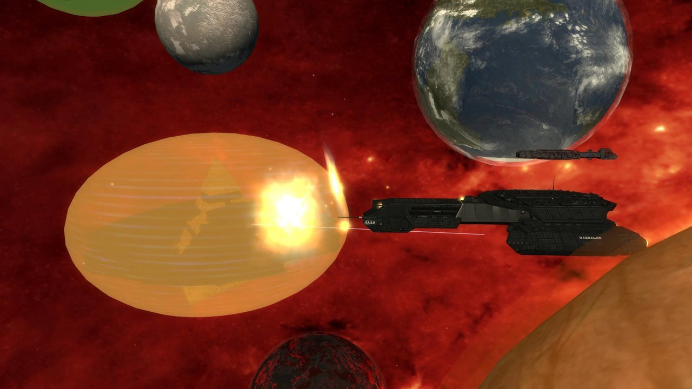
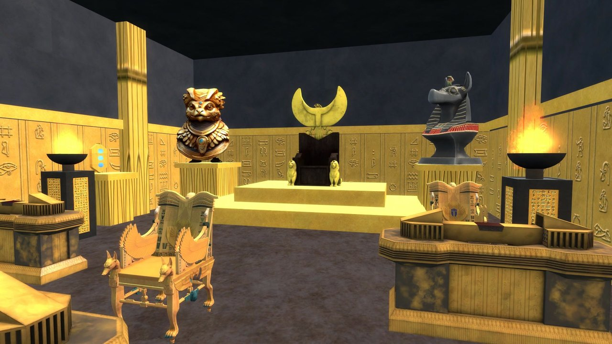
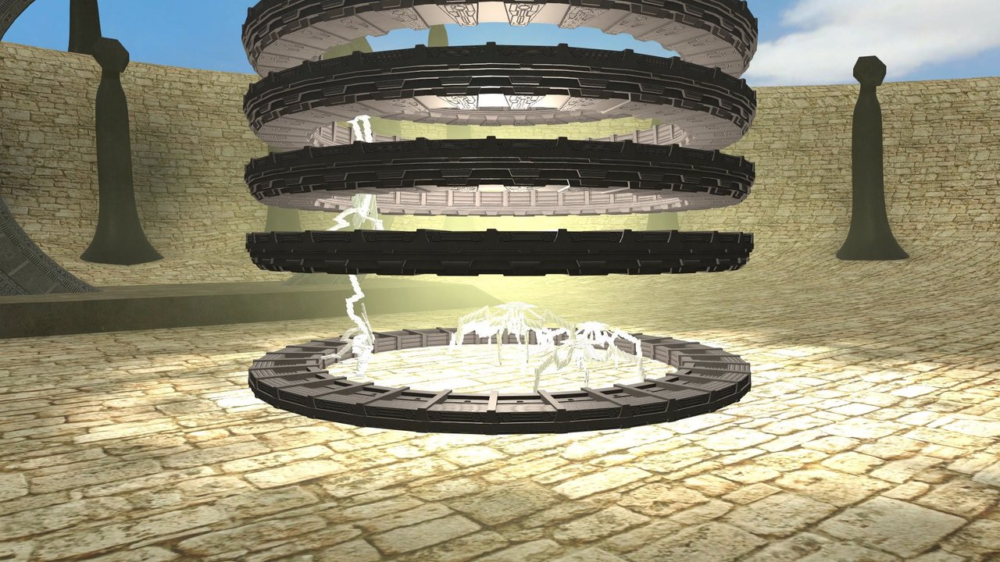
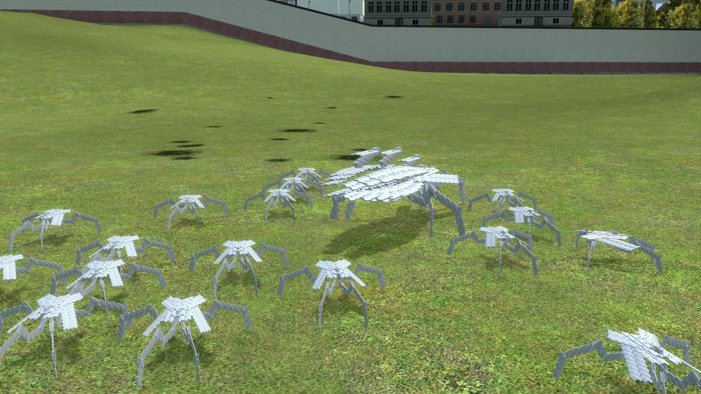
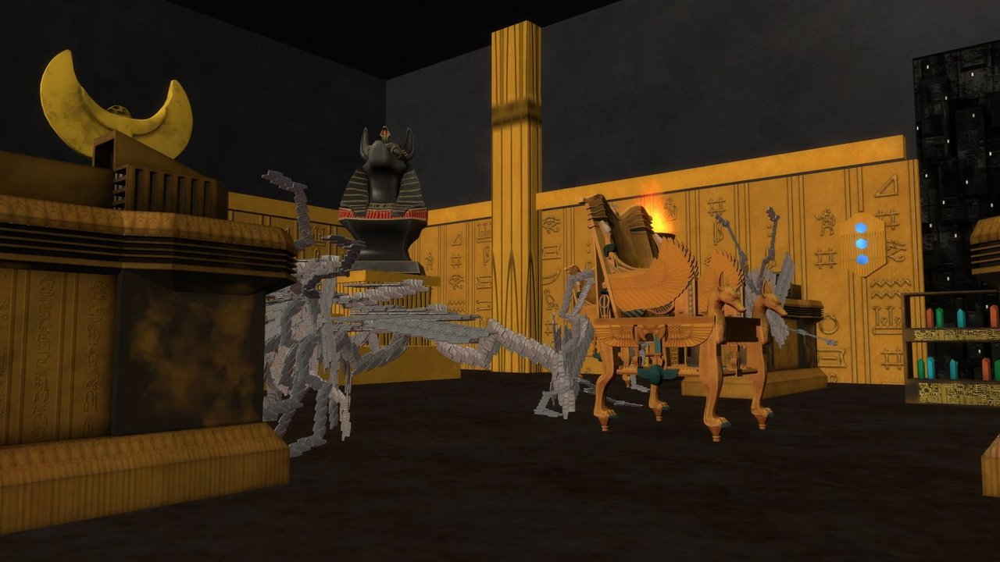
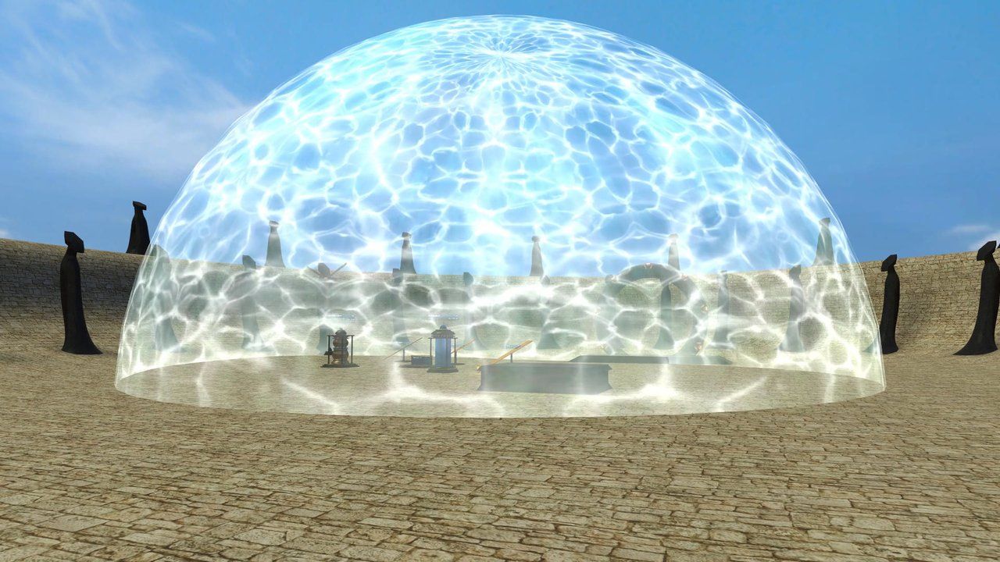

---

## What's inside

### Stargates and rings
- Milky Way (SG-1), Pegasus (Atlantis), Universe, Supergate, Movie, Infinity, Orlin, Tollan, Alteran and Virgo gates
- DHDs, iris and Goa'uld iris, iris computer, GDO, mobile DHD
- Ring transporters with panels and a hand-held ring caller

### Ships
- **Ha'tak** you can walk through (where the map has room for it): five decks, pel'tak, gate room, glider bay, barracks, sarcophagus. Power crystals feed every system - pull one and that system gets weaker. Strangers can steal the ship with the control crystal, unless the server switches that off.
- Death Glider, Al'kesh, Tel'tak, Puddle Jumper, F-302, Daedalus, Wraith Dart
- Aurora, Destiny, O'Neill, Prometheus, Ori Mothership, Wraith Cruiser, Replicator Mothership, Traveler, Gate Seeder
- Hyperspace windows, shields, cloaks
- Ship weapons for your own builds - Asgard Beam Weapon, Ha'tak Staff Cannon, Drone Launcher, Ori Beam Cannon, Destiny turrets, Ship Railgun, Ion Cannon, Vanir and Wraith Plasma Cannons: they never hit their own ship and fire out through its own shield. On a StarCore ship they run on the ship's power (its ZPMs, generators and batteries, else the ship's own). Admins choose if weapons use energy, and how hard they hit a StarCore ship: as in the series (hand weapons barely scratch a hull) or each weapon's own damage.

### Replicators
- Blocks crawl together and build bugs, bugs build more bugs, queens lead the swarm
- They eat metal, follow you through the gate and put themselves back together after a blast
- Only three things finish them: the Dakara weapon, the ARG and an opening gate's kawoosh
- Still being tuned: how they move and fight can change from update to update

### Weapons and gear
Zat'nik'tel, staff weapon, hand device, healing device, SGC PDW (P90), SGC Sidearm (Beretta), Ori staff, Wraith blaster, Ronon's gun, Asuran gun, Tac, personal shield, Sodan cloak, mimetic imaging device and the Ancient control chair with drones.

### Power and life support
ZPMs, naquadah generators and the Goa'uld power hub run on **PowerGrid**. In space there is no air and it is cold: suits, life support and a short report of what waits behind a gate before you step through.

### Help in the game
Type **agp_wiki** in the console, or Q > Ascension Gates > Config > Help. Every part, every key, in short steps.

---

## Required
Steam lists them under *Required Items* and offers to subscribe you to them along with this one:
- Ascension Gates - Resources 1, 2 and 3 (models, sounds, maps, materials)
- PowerGrid (energy network and life support)
- [Wiremod](https://steamcommunity.com/sharedfiles/filedetails/?id=160250458) (Wire inputs and outputs, E2)

**Everything in one click:** [Ascension Gates - Complete](https://steamcommunity.com/sharedfiles/filedetails/?id=3840681489)

Optional, made to work with it: **StarCore** (turn your own build into a ship), **Black Hole Cache**, **SpaceGrid** (build ships and stations).

## Using CAP or CAP Enhanced?
Ascension Gates already includes their parts, under the same file names. Please keep only one of them subscribed. With both, there is no telling which version of a part the game loads.

## First steps
1. Press Q and open the **Ascension Gates** tab.
2. Spawn two Stargates and a DHD (category StarGates and Rings).
3. Look at the DHD, press E and dial the other gate.
4. Walk through.

## Privacy
Ascension Gates collects nothing. From the Workshop it never goes online - Steam keeps it up to date. Installed by hand from GitHub, it has a "Check for updates" button: that asks GitHub for the newest version number and sends nothing about you.

---

## Licence
Pack under [CC BY-NC-SA 4.0](https://creativecommons.org/licenses/by-nc-sa/4.0/); Lua files with a GPL header stay GPL v3. Free, no commercial use. Stargate is a trademark of MGM. This is a free fan project, not connected to MGM or Amazon.

## Credits
Ascension Gates is built on the work of these people - thank you:
- **Carter's Addon Pack**: Rafaël De Jongh, Madman07, Llapp, locotus_1, AlexALX and all CAP contributors - [github.com/RafaelDeJongh/cap](https://github.com/RafaelDeJongh/cap)
- **CAP Enhanced**: Soren MC - the base of this pack (D.B Creation: control chair model)
- Gate spawner files: PhaserArray (2929788339) and the authors of 270029801, 2819482348, 114313290, 277745562, 270021962
- Sketchfab models (CC BY 4.0 unless noted): P90 by Rotuma, Beretta 92 by romunql, Reactor Core by Daniel Aucar Felipe; Ha'tak consoles, chests, staff, grenades, Al'kesh and Death Glider by Ska-Ara (CC BY-NC-SA 4.0); Ha'tak props by Andres Piroso, R08, electricdreams86, Henri1230, Zambur, hdl-infographiste, VUC, 3dworldvibes, creo14, reddification, TaurWing, klrxyz; Atlantis city ship by Ace_Fighter (CC BY-NC 4.0)

The full list with links is in the game (Credits) and inside the addon (lua/agp_license.lua).
